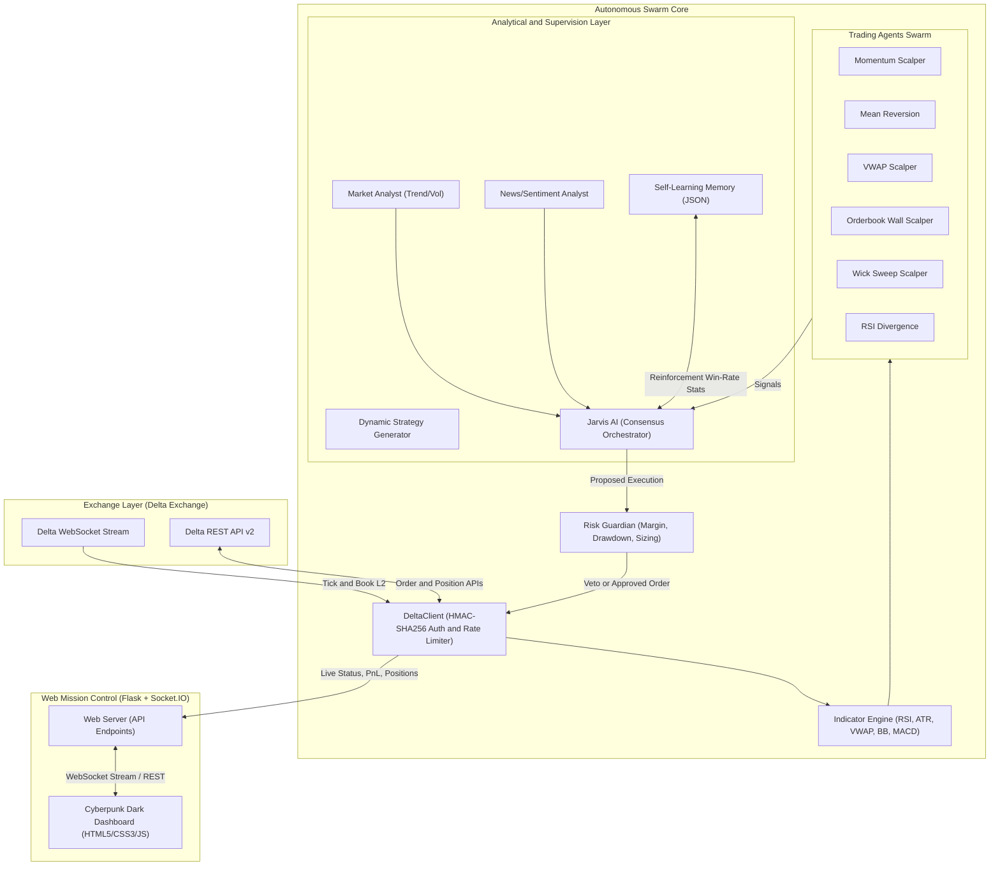
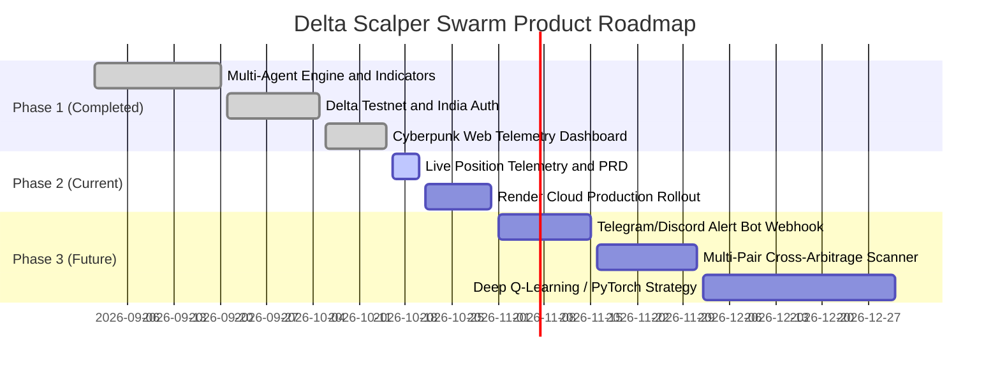

# 📑 Product Requirement Document (PRD)

## Delta Exchange Autonomous Scalper Swarm
**High-Frequency Multi-Agent Algorithmic Trading System**

---

| Attribute | Details |
| :--- | :--- |
| **Document Version** | 1.0.0 |
| **Status** | Approved / Live in Production (Testnet & India Mainnet Ready) |
| **Author** | Antigravity AI Engineering Team |
| **Target Platforms** | Delta Exchange India (`india.delta.exchange`), Delta Global / Testnet (`demo.delta.exchange`) |
| **Repository** | `https://github.com/lets-make-ashwani/delta-bot.git` |
| **Runtime Stack** | Python 3.10+, Flask, Socket.IO, NumPy, Pandas, TA-Lib, HTML5/CSS3/Vanilla JS |
| **Cloud Deployment** | Render Cloud (Free / Starter Web Service Tier) |

---

## 1. Executive Summary & Product Vision

### 1.1 Executive Summary
The **Delta Exchange Autonomous Scalper Swarm** is an institutional-grade, multi-agent quantitative trading system engineered specifically for perpetual contracts and futures on Delta Exchange. Operating in ultra-low latency regimes, the platform deploys an ensemble of autonomous specialized bots (Momentum, Mean Reversion, VWAP, Orderbook Wall, Wick Sweep, RSI Divergence) supervised by an AI Meta-Orchestrator (**Jarvis AI**) and a strict **Risk Guardian**.

The system features real-time live position telemetry, sub-second market data ingestion, dynamic leverage adjustment (up to 100x), continuous self-learning memory, and a web-based cyberpunk-styled mission control dashboard.

### 1.2 Vision Statement
> *"To democratize institutional-grade high-frequency algorithmic scalping by fusing decentralized multi-agent consensus, real-time liquidity detection, and automated risk enforcement into a zero-maintenance, cloud-native platform."*

---

## 2. Target Personas & Stakeholders

| Persona | Description | Primary Needs |
| :--- | :--- | :--- |
| **Quantitative Scalper** | Experienced derivatives trader operating on high leverage. | Sub-second order execution, slippage prevention, orderbook wall detection, granular position telemetry. |
| **Retail Crypto Investor** | Busy individual seeking automated passive yield on crypto holdings. | Safe automated risk controls, capital preservation, clean mobile-responsive dashboard, "one-click" start/stop. |
| **Risk & Compliance Lead** | Overseer focused on mitigating liquidation risk and account drawdown. | Hard circuit breakers, max daily loss limits, automatic trailing stop loss, position size caps. |

---

## 3. System Architecture & Component Interaction

---

## 4. Functional Requirements (FR)

### 4.1 Exchange Integration & Cryptographic Authentication
- **FR-1.1**: The system must authenticate all private API requests using HMAC-SHA256 signatures generated from `api-key`, `timestamp`, and `signature`.
- **FR-1.2**: Must seamlessly switch between Delta Testnet (`https://testnet-api.delta.exchange`) and Delta India Production (`https://api.india.delta.exchange`) via `.env` configuration.
- **FR-1.3**: Automatic nonce/timestamp synchronization with jitter correction to avoid `timestamp out of bounds` errors.
- **FR-1.4**: Automatic handling of API rate limits (exponential backoff with retry headers).

### 4.2 Multi-Agent Scalper Swarm
The system must run independent strategy modules that continuously analyze multi-timeframe candles (1m, 3m, 5m, 15m) and book snapshots:
- **FR-2.1 (Momentum Scalper)**: Triggers directional scalp entries on EMA (9/21) crossovers backed by MACD histogram momentum and ADX > 25.
- **FR-2.2 (Mean Reversion)**: Triggers counter-trend scalps when price pierces 2.5σ Bollinger Bands and RSI enters extreme oversold (<20) or overbought (>80) zones.
- **FR-2.3 (VWAP Scalper)**: Calculates intraday Volume-Weighted Average Price and enters on high-volume pullbacks to VWAP standard deviation bands.
- **FR-2.4 (Orderbook Wall Scalper)**: Real-time L2 orderbook parsing to identify institutional bid/ask liquidity walls (>500 contracts) and front-run bounce reactions.
- **FR-2.5 (Wick Sweep Scalper)**: Detects liquidity sweeps above recent swing highs or below swing lows (stop hunts) evidenced by long rejection wicks.
- **FR-2.6 (RSI Divergence)**: Detects regular and hidden bullish/bearish divergences between price peaks and RSI oscillator peaks.

### 4.3 Jarvis AI & Consensus Engine
- **FR-3.1**: Collects signals from all active bots and scores them by historical win-rate weightings.
- **FR-3.2**: Enforces minimum consensus threshold (e.g., at least 2 correlating signals or Jarvis score > 0.70) before greenlighting an order.
- **FR-3.3**: Considers overall market regime (Bullish Trend, Bearish Trend, Ranging, High Volatility) from the Market Analyst module before allowing counter-trend trades.

### 4.4 Risk Guardian & Capital Protection
- **FR-4.1 (Position Sizing)**: Dynamically caps risk per trade to a configured percentage of account equity (default: 1.0% - 2.0%).
- **FR-4.2 (Hard Stop Loss & Take Profit)**: Every market order must immediately attach an ATR-based bracket stop loss and dynamic take profit.
- **FR-4.3 (Account Circuit Breaker)**: Automatically freezes new order execution if daily drawdown reaches the configured threshold (e.g., -5.0%).
- **FR-4.4 (Max Concurrent Positions)**: Limits maximum open positions (default: 3 concurrent positions) to prevent margin exhaustion.
- **FR-4.5 (Emergency Flatten)**: Provides a single-click emergency kill-switch (`/api/emergency_close`) that cancels all open limit orders and market-closes all active positions.

### 4.5 Self-Learning Memory & Dynamic Adaptation
- **FR-5.1**: Persists trade outcomes (entry price, exit price, PnL, duration, strategy name, market volatility) into `learning_memory.json`.
- **FR-5.2**: Incrementally raises allocation weights of strategies displaying statistical edge (>60% win rate over last 20 trades) and down-weights underperforming strategies.

### 4.6 Web Control Mission Control (Dashboard)
- **FR-6.1**: Real-time display of total portfolio equity in both USD ($) and converted INR (₹).
- **FR-6.2**: Live telemetry of **each active position**:
  - Symbol / Contract name
  - Direction (LONG / SHORT with colored badges)
  - Number of Contracts & Position Value
  - Leverage applied (e.g., 50x / 100x)
  - Entry Price vs. Live Mark Price
  - Liquidation Price & Margin Ratio
  - Real-time Unrealized PnL ($ and % ROE)
- **FR-6.3**: Interactive controls:
  - Global Bot Swarm Toggle (ON / OFF / DRY-RUN)
  - Individual Bot Strategy Toggles
  - Risk tolerance selector (Conservative, Moderate, Aggressive)
  - Emergency Panic Button (Liquidate All)
- **FR-6.4**: Real-time streaming log terminal with color-coded log levels (INFO, SUCCESS, WARNING, ERROR).

---

### 4.7 Platform Brokerage & Net Profit/Loss Accounting
- **FR-7.1 (Exchange Fee Modeling)**: Automatically applies Delta Exchange fee schedules (0.05% Taker fee, 0.02% Maker fee) on notional turnover for both entry and exit legs.
- **FR-7.2 (Delta India GST Accounting)**: Incorporates the mandatory 18% GST applicable to all derivative trading brokerage.
- **FR-7.3 (Transparent Gross vs. Net Reporting)**: All trade metrics and ledgers explicitly report:
  - **Gross P&L**: Raw price move gain/loss.
  - **Platform Brokerage**: Total exchange transaction fees + GST.
  - **Net Take-Home P&L**: Real cash credited or debited after exchange deductions ($Gross - Brokerage$).
- **FR-7.4 (Live Position Brokerage Estimator)**: For every active open position, computes estimated round-trip brokerage and live **Net Unrealized P&L** so the trader knows their exact post-fee profit/loss before clicking close.
- **FR-7.5 (Fee Drag & Net Win Rate)**: Tracks the percentage of profits consumed by exchange fees (Fee Drag %) and computes win rate strictly based on **Net Positive Trades** to avoid high-volume negative-churn scalping.

## 5. Non-Functional Requirements (NFR)

### 5.1 Performance & Latency
- **NFR-1.1**: Market signal evaluation cycle must execute within < 250 milliseconds per symbol.
- **NFR-1.2**: Dashboard UI polling / WebSocket updates must deliver live state in < 1.0 second intervals.

### 5.2 Reliability & Fault Tolerance
- **NFR-2.1**: Uptime target of 99.9% when deployed on 24/7 cloud infrastructure.
- **NFR-2.2**: Automatic WebSocket heartbeat reconnection with exponential backoff on network disconnects.
- **NFR-2.3**: Unhandled exceptions within any individual strategy bot must not crash the orchestrator or other bots.

### 5.3 Security & API Key Safety
- **NFR-3.1**: Private API keys and secrets must only be loaded from environment variables (`.env`). Keys must never be hardcoded or logged in plaintext.
- **NFR-3.2**: Delta Exchange IP whitelisting must be supported and enforced for production accounts.
- **NFR-3.3**: All communications with Delta Exchange and Web Dashboard must occur over encrypted TLS (HTTPS / WSS).

---

## 6. Cloud Deployment & Storage Architecture (Render Specifications)

The bot is designed to run 24/7 on Render's Free or Starter tier with zero cost:

| Resource Dimension | Specification / Footprint | Render Free Limit | Utilization |
| :--- | :--- | :--- | :--- |
| **Total Disk Space** | **~170 MB - 180 MB** | 10.0 GB | **~1.7%** (Safe) |
| **Active RAM Usage** | **~140 MB - 190 MB** | 512 MB | **~35%** (Safe) |
| **CPU Usage** | **0.05 - 0.20 vCPU** | Shared vCPU | Low / Optimal |
| **Persistent Disk** | Not Required (Ephemeral Storage) | N/A | Ephemeral storage suffices |
| **Log Management** | Rotating memory buffer (max 1,000 lines) | N/A | Zero unbounded disk growth |

### Deployment Files Provided:
- `Procfile`: `web: gunicorn --worker-class eventlet -w 1 web_server:app --bind 0.0.0.0:$PORT`
- `render.yaml`: Infrastructure-as-code blueprint for one-click deployment.
- `requirements.txt`: Lightweight, pinned dependency tree.

---

## 7. Key Performance Indicators (KPIs) & Target Metrics

| Metric | Target Goal | Minimum Acceptable |
| :--- | :--- | :--- |
| **Swarm Win Rate** | >= 68.0% | 55.0% |
| **Profit Factor** | >= 1.90 | 1.40 |
| **Maximum Drawdown** | <= 4.5% | <= 8.0% |
| **Sharpe Ratio** | >= 2.20 | >= 1.50 |
| **Average Trade Duration** | 45s - 300s (Scalp) | < 15 min |
| **Order Fill Ratio** | >= 98.5% | >= 95.0% |

---

## 8. Release Roadmap

---

## 9. Sign-off & Revision History

| Version | Date | Author / Team | Summary of Changes |
| :--- | :--- | :--- | :--- |
| **0.1.0** | 2026-09-15 | Quant Dev Team | Initial technical architecture & bot designs. |
| **0.5.0** | 2026-10-01 | Full Stack Eng | Integration of Flask/Socket.IO dashboard and Delta client. |
| **0.9.0** | 2026-10-14 | Systems Lead | Verification of live Testnet order flows & HMAC auth. |
| **1.0.0** | 2026-10-16 | Antigravity AI | Official PRD release: real-time position telemetry, cloud specs, and swarm coordination. |
